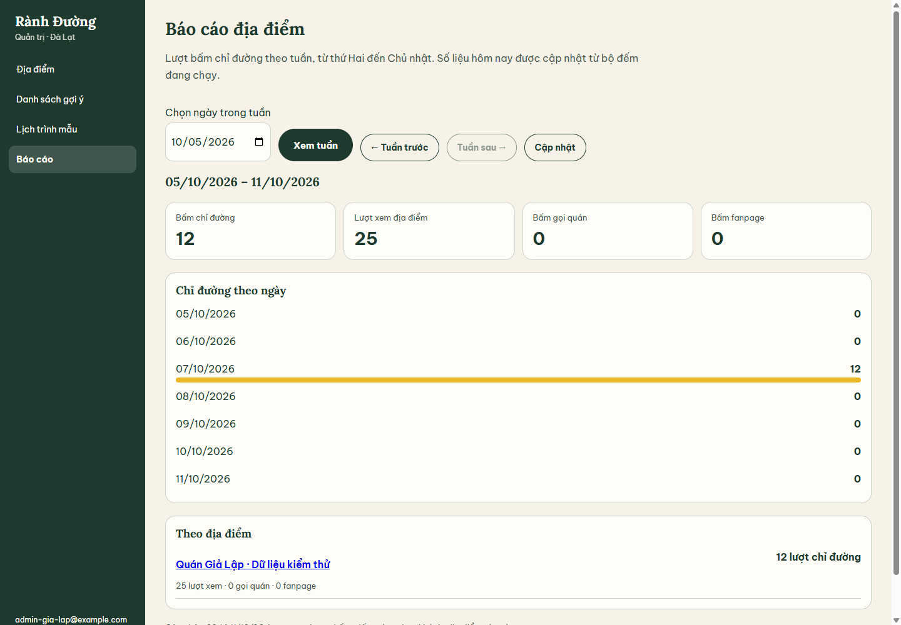
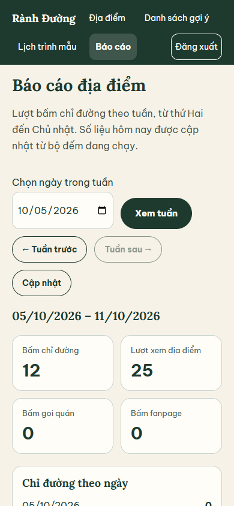
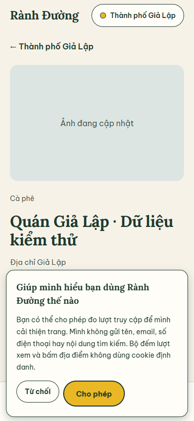

# S18 — Tracking và báo cáo

Nhánh `feat/S18-tracking-reports`. Web gửi lượt xem địa điểm và lượt bấm chỉ đường/gọi quán/fanpage đến API. Redis giữ bộ đếm; cron trong API gộp hằng ngày vào `place_metrics` theo ADR 0012. Admin có mục **Báo cáo** tại `/bao-cao`, xem theo tuần thứ Hai–Chủ nhật ở giờ Việt Nam, tổng từng ngày và từng địa điểm. Ngày đang chạy lấy thêm số liệu Redis, không cộng lại dữ liệu đã gộp.

## Cấu hình

Biến API đọc qua `loadEnv()`:

```dotenv
REDIS_URL=redis://localhost:6379
WEB_ORIGINS=https://ranhduong.vn,https://admin.ranhduong.vn
TRUSTED_PROXY_CIDRS=
```

`TRUSTED_PROXY_CIDRS` là danh sách IP/CIDR của proxy thực sự đứng trước API, phân cách bằng dấu phẩy. Local để trống. Production điền đúng mạng/proxy của hạ tầng S02; Express chỉ đọc IP từ forwarding header khi kết nối đến từ proxy được tin cậy. Không dùng giá trị `true` hoặc tin mọi nguồn. API vẫn kiểm Origin khi nhận sự kiện; báo cáo yêu cầu phiên admin.

Biến runtime trên tiến trình Nuxt:

```dotenv
NUXT_PUBLIC_INDEXABLE=true
NUXT_PUBLIC_TRACKING_ENABLED=true
NUXT_PUBLIC_UMAMI_SCRIPT_URL=
NUXT_PUBLIC_UMAMI_WEBSITE_ID=
```

S18 tích hợp Umami mặc định, chưa có instance thật trong checkout. Tạo website trên instance Umami, điền URL `script.js` và Website ID do instance cấp, rồi khởi động lại web. Khi thiếu cấu hình, web không tải script hoặc hiện bảng xin phép. Staging đặt `NUXT_PUBLIC_INDEXABLE=false` và `NUXT_PUBLIC_TRACKING_ENABLED=false`; không gửi cả traffic lẫn bộ đếm địa điểm. Không dùng chung cache production/staging.

## Sự kiện và quyền riêng tư

`POST /v1/events` nhận JSON, trả `202 { "accepted": n }`, `Cache-Control: no-store`:

```json
{
  "events": [
    { "type": "place_view", "placeId": "0123456789abcdef01234567", "source": "list" },
    { "type": "direction_click", "placeId": "0123456789abcdef01234567" }
  ]
}
```

ID trên là dữ liệu minh hoạ. Mỗi lô có 1–20 sự kiện; schema strict không nhận IP, email hoặc dữ liệu tự do. Loại hỗ trợ: `place_view`, `direction_click`, `call_click`, `fanpage_click`. Nguồn lượt xem: `direct`, `search`, `list`, `itinerary`, `map`. Chỉ địa điểm active/closed thuộc thành phố active được nhận; ID không tồn tại hoặc riêng tư bị bỏ qua. `accepted` tính sau chống đếm trùng, không cho biết tên/trạng thái địa điểm bị bỏ qua.

Giới hạn 120 yêu cầu trong 60 giây trượt mỗi IP bằng Lua/ZSET nguyên tử. Header giả không đổi IP nếu proxy chưa được tin cậy. Hash giới hạn giữ cùng salt qua nửa đêm; salt hết hạn sau 2 phút không có yêu cầu, các khóa giới hạn hết hạn sau 60 giây. Lượt xem dùng hash IP + User-Agent + salt theo ngày Việt Nam, chia sẻ giữa các API instance; khóa `seen:{hash}:{placeId}:{dayKey}` TTL 1 ngày. Không dùng cookie định danh và không lưu sự kiện thô, IP hoặc User-Agent vào MongoDB.

Client gom lô tối đa 20, bộ nhớ tối đa 100 sự kiện, flush mỗi giây và khi bấm liên kết/pagehide/ẩn tab; fetch `keepalive` không giữ người dùng chờ. Không tự gửi lại khi kết quả mạng không rõ để tránh đếm trùng lượt bấm. Lượt xem được ghi khi hydrate trang địa điểm hoặc chọn địa điểm trên bản đồ; bấm chỉ đường trong lịch trình dùng cùng ID địa điểm.

Umami chỉ tải sau khi khách chọn **Cho phép**. **Từ chối**, thu hồi ở cuối trang, thu hồi/xóa lựa chọn trong tab khác, DNT hoặc Global Privacy Control đều chặn gửi. Lựa chọn lưu bằng localStorage; không dùng nó làm ID người dùng. Umami tắt auto-track và chỉ gửi pageview thủ công: pathname công khai đã bỏ query/hash, tiêu đề cố định “Rành Đường”, referrer rỗng; không gửi tên quán, tên khách, email, số điện thoại, nội dung tìm kiếm hoặc dữ liệu sự kiện tự do. Các URL `/l`, `/admin`, `/owner` bị bỏ. Bộ đếm địa điểm độc lập với lựa chọn analytics, đúng ADR 0012.

Tham khảo cấu hình và API chính thức: [Umami tracker configuration](https://docs.umami.is/docs/tracker-configuration), [tracker functions](https://docs.umami.is/docs/tracker-functions).

## Rollup và báo cáo

- Redis giữ hash `pm:{placeId}:{dayKey}`, cityId lúc nhận và chỉ mục ngày trong 8 ngày. Khi địa điểm/thành phố bị ẩn sau đó, số đã nhận vẫn được gộp.
- API chạy catch-up khi khởi động và lịch 00:15 `Asia/Ho_Chi_Minh`; chỉ gộp ngày đã qua, có 15 phút chờ yêu cầu trước nửa đêm hoàn tất. Không cần khởi động worker BullMQ cho rollup.
- MongoDB có unique index `{ placeId, dayKey }` và index `{ cityId, dayKey }`. Chờ index trước ghi; upsert số tuyệt đối bằng `$max`. Retry hoặc nhiều API cùng chạy không cộng lại số cũ. Chỉ xác nhận xong ngày sau khi ghi đủ mọi địa điểm.
- Lỗi gộp giữ ngày pending, thử tối đa 5 lần với chờ 1/2/4/8 giây; đợt cron sau hoặc khởi động lại tiếp tục catch-up. Theo ADR 0012, mất Redis chưa gộp là giới hạn được chấp nhận. Collection không phải nhật ký sự kiện.
- `GET /v1/admin/cities/:city/metrics?week=YYYY-MM-DD` chuẩn hoá ngày chọn về thứ Hai. Thiếu week lấy tuần hiện tại, tuần tương lai trả 400. API yêu cầu admin và trả `no-store`.
- Báo cáo có đủ 7 ngày, tổng xem/chỉ đường/gọi/fanpage, địa điểm xếp theo lượt chỉ đường giảm dần. Dữ liệu đã gộp và Redis lấy giá trị lớn hơn cho từng chỉ số/ngày; số liệu cũ vẫn hiển thị khi Redis đã hết TTL. Địa điểm đã ẩn/đóng còn trong báo cáo; nháp không xuất hiện.
- Admin có chọn ngày, tuần trước/sau, cập nhật, trạng thái chưa có số liệu và lỗi/thử lại/đăng nhập lại. Nút tiếp đến tuần tương lai bị khóa.

## Kiểm chứng local

```bash
pnpm turbo run lint typecheck test build
pnpm --filter @ranhduong/web test:ssr
```

20/20 task workspace đã qua: contracts 320, geo 37, API 345, admin 110, web 78 test. API chạy với MongoDB/Redis thật: lô/Origin/quyền admin, chống trùng khi đồng thời, cửa sổ trượt và nửa đêm, retry/catch-up/gộp đồng thời, ranh giới 00:15, bảo toàn số liệu khi ẩn và tổng tuần. Test plugin analytics thực kiểm việc thu hồi ở tab khác và xóa storage. 59 test SSR kiểm metadata/cache cùng ID/link tracking mà không tải script analytics phía server. Review độc lập đã kiểm và các lỗi phát hiện có hồi quy.

Chrome headless trên production build tại 390px/1440px đã qua: từ chối/cho phép/thu hồi/cho phép lại, đồng bộ storage giữa tab, DNT, staging, click chỉ đường/gọi/fanpage/lịch trình, flush pagehide; admin tuần trước/sau, tuần trống, hết phiên/thử lại. Không tràn ngang hoặc lỗi runtime/hydration. Test hit-target xác nhận bảng đã đóng không che nút liên hệ trên điện thoại; nút mở lại lựa chọn nằm cuối trang.

Ảnh dưới đây dùng dữ liệu **Giả Lập**, không phải thống kê thật:





## Trước khi nghiệm thu vận hành

- [ ] Cấp URL script/Website ID của instance Umami thật; kiểm pageviews chỉ xuất hiện sau khi cho phép, không có query/referrer/tên/email/điện thoại.
- [ ] CI remote và triển khai staging; kiểm IP thật với proxy allowlist của S02 và staging không phát telemetry.
- [ ] Production: tạo sự kiện, kiểm báo cáo admin và một lần rollup qua 00:15; chỉ API admin đọc được báo cáo.
- [ ] Thử trên điện thoại Android/iPhone thật: liên kết bản đồ/gọi/fanpage không bị bảng tuỳ chọn đã đóng che; thu hồi consent và pagehide.
- [ ] Theo dõi Sentry 24 giờ sau deploy khi S19 đã cấu hình.
